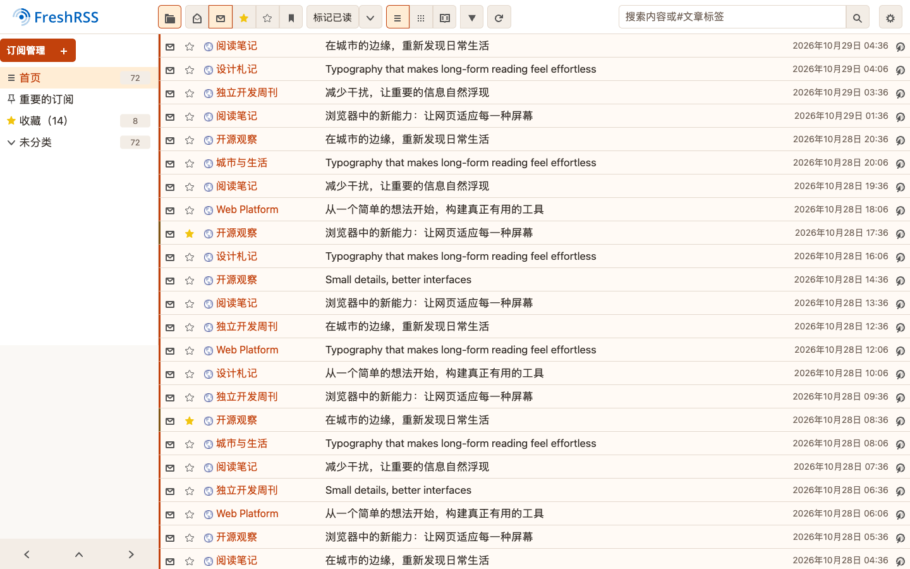
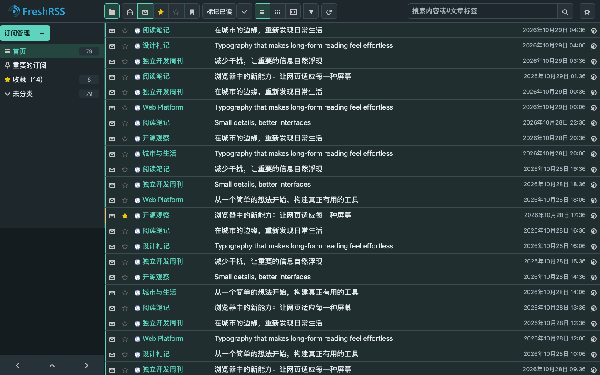

# Crisp for FreshRSS

紧凑、扁平的 FreshRSS 主题，提供 **Crisp Light** 和 **Crisp Dark** 两套固定配色。

Compact, flat themes for FreshRSS, available as **Crisp Light** and **Crisp Dark** with fixed colour palettes.

[中文说明](#中文说明) · [English](#english) · [截图 Screenshots](#截图-screenshots)

## 截图 Screenshots

### Crisp Light

暖白底色、暖灰文字与橙色强调色。截图使用示例订阅内容。

Warm white surfaces, warm grey text and burnt-orange accents. The screenshot uses sample feeds.



### Crisp Dark

墨灰底色、柔和浅色文字与青绿色强调色。截图使用示例订阅内容。

Ink-grey surfaces, soft light text and teal accents. The screenshot uses sample feeds.



## 中文说明

### 设计

Crisp 以 FreshRSS 自带的 Flat design 为起点，通过底色、细分隔线与小圆角区分界面层级。
两套主题共用组件样式与布局，分别定义配色，保持阅读和操作体验一致。

- **紧凑列表**：减少订阅列表和文章列表的上下留白，适当增大文字，正文保留舒适行距。
- **合并顶栏**：搜索框与“标记已读”等操作排列在同一栏，窄屏或浏览器放大后自动换行。
- **简化日期分组**：按接收、发布或修改时间排序时，隐藏日期分组标题和跳转链接，保留文章时间与来源、分类分组。
- **固定配色**：在 FreshRSS 中选择浅色或深色主题，不随系统颜色偏好变化。
- **支持 RTL**：随主题提供从右向左书写语言所需的样式文件。

### 安装

需要已有的 FreshRSS 安装。本仓库仅包含主题，基础样式与图标由 FreshRSS 提供。

1. 下载本仓库，或使用下面的命令克隆。
2. 将仓库中的 **`Crisp` 和 `Crisp-Dark` 两个目录**复制到 FreshRSS 的 `p/themes/` 目录。
3. 在 FreshRSS 的显示设置中选择 **Crisp Light** 或 **Crisp Dark**。

```sh
git clone https://github.com/wookiisky/Freshrss-Theme-Crisp.git
cp -R Freshrss-Theme-Crisp/Crisp Freshrss-Theme-Crisp/Crisp-Dark /path/to/FreshRSS/p/themes/
```

请将 `/path/to/FreshRSS` 替换为实际安装路径。两个主题目录必须保持原名、位于同一级；
深色主题会从 `Crisp` 目录加载共享的 CSS 和 JavaScript，因此需要一起安装。

### 文件与测试

- `Crisp/light.css`：浅色配色。
- `Crisp-Dark/dark.css`：深色配色。
- `Crisp/crisp.css` 与 `Crisp/layout.css`：共享组件样式和响应式布局。
- `Crisp/crisp.js`：移动原有工具栏并识别日期排序，保留现有控件与事件处理。
- `*.rtl.css`：生成的 RTL 样式，维护时应从对应 CSS 重新生成。

在仓库根目录运行现有交互测试，需要支持 `node --test` 的 Node.js：

```sh
node --test tests/frontend/crisp.test.mjs
```

### 来源与许可

设计参考 [FreshRSS](https://github.com/FreshRSS/FreshRSS) 的 Flat design 主题。
本仓库保留 FreshRSS 的 GNU AGPL v3 许可证，详见 [LICENSE.txt](LICENSE.txt)。

## English

### Design

Crisp starts from FreshRSS's bundled Flat design theme and uses surface colours, fine dividers and small corner radii to distinguish interface elements.
Both editions share component styles and layout, with separate palettes for a consistent reading experience.

- **Compact lists**: less vertical space in feed and article lists, larger text and comfortable article line spacing.
- **Combined header**: search and reading controls share one toolbar, wrapping on narrow screens or when zoomed in.
- **Simpler date grouping**: date headings and jump links are hidden when sorting by reception, publication or modification time. Article dates, feed groups and category groups remain available.
- **Fixed palettes**: select the light or dark edition in FreshRSS; neither follows the operating system's colour preference.
- **RTL support**: generated stylesheets are included for languages written from right to left.

### Installation

An existing FreshRSS installation is required. This repository contains themes only; FreshRSS provides the base styles and icons.

1. Download this repository or clone it with the command below.
2. Copy **both `Crisp` and `Crisp-Dark` directories** into FreshRSS's `p/themes/` directory.
3. Select **Crisp Light** or **Crisp Dark** in FreshRSS's display settings.

```sh
git clone https://github.com/wookiisky/Freshrss-Theme-Crisp.git
cp -R Freshrss-Theme-Crisp/Crisp Freshrss-Theme-Crisp/Crisp-Dark /path/to/FreshRSS/p/themes/
```

Replace `/path/to/FreshRSS` with your installation path. Keep the original directory names and install them side by side.
The dark edition loads shared CSS and JavaScript from `Crisp`, so both directories must be installed together.

### Files and tests

- `Crisp/light.css`: light palette.
- `Crisp-Dark/dark.css`: dark palette.
- `Crisp/crisp.css` and `Crisp/layout.css`: shared component styles and responsive layout.
- `Crisp/crisp.js`: moves the existing toolbar and identifies date sorting while preserving controls and event handlers.
- `*.rtl.css`: generated RTL stylesheets; regenerate these from their corresponding CSS files when maintaining the styles.

Run the existing interaction tests from the repository root using a Node.js version that supports `node --test`:

```sh
node --test tests/frontend/crisp.test.mjs
```

### Credits and licence

Inspired by the Flat design theme bundled with [FreshRSS](https://github.com/FreshRSS/FreshRSS).
This repository retains FreshRSS's GNU AGPL v3 licence; see [LICENSE.txt](LICENSE.txt).
