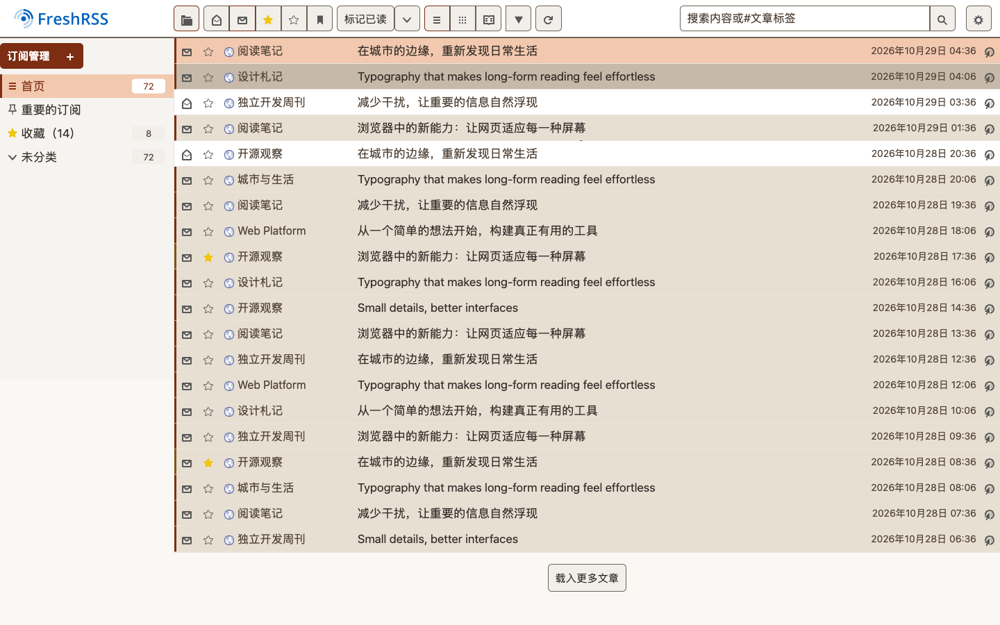
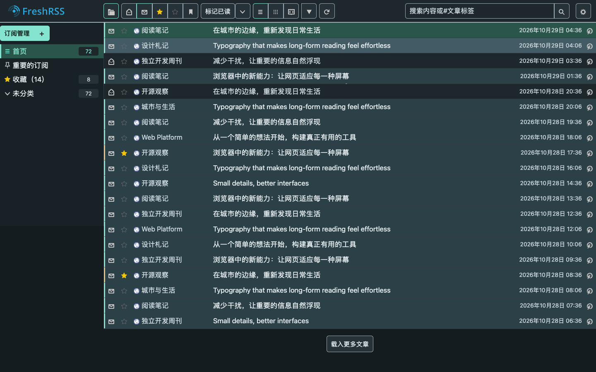

# Crisp for FreshRSS

[English](README.md) | [简体中文](README.zh-CN.md)

Compact, flat themes for FreshRSS, available as **Crisp Light** and **Crisp Dark** with fixed colour palettes.

## Screenshots

The screenshots use sample feeds to show the current styles: the first article is selected, the second is hovered, the third and fifth are read, and the remaining articles are unread.

### Crisp Light

Warm white surfaces, warm grey text and burnt-orange accents. The screenshot uses sample feeds.



### Crisp Dark

Ink-grey surfaces, soft light text and teal accents. The screenshot uses sample feeds.



## Design

Crisp starts from FreshRSS's bundled Flat design theme and uses surface colours, fine dividers and square corners to distinguish interface elements.
Both editions share component styles and layout, with separate palettes for a consistent reading experience.

- **Compact lists**: less vertical space in feed and article lists, larger text and comfortable article line spacing.
- **Article colour hierarchy**: light articles use warm brown, teal and blue-grey headings with golden-brown bold text; dark articles use soft coral, pale teal and misty blue headings with pale-gold bold text. H1–H6 have separate colours, with lower levels converging towards blue-grey while retaining their existing size, weight and spacing. Highlights use a pale-wheat background with dark-brown text in light mode, and a dark olive-gold background with pale-beige text in dark mode. Italics keep their surrounding colour; bold text inside headings, links, code and highlights keeps its context colour. Source inline colours remain intact.
- **Article spacing**: ordinary paragraphs use a `1.395` line height and `0.54em` above and below. Direct article text and simple text containers use the same line height. Article bodies have no vertical padding; when the first or last content belongs to an ordinary paragraph, its outward margin is also removed. Article headings use `1.4em` above and `0.6em` below. Empty paragraphs and simple containers containing only whitespace, `&nbsp;` or breaks are hidden. Leading and trailing breaks in articles and ordinary blocks are hidden; consecutive breaks between content become a single line break without an extra blank line. Paragraphs containing code or preformatted text retain their original spacing and inherited line height.
- **Simpler subscription sidebar**: unread counts have no background, align to the trailing edge and reserve only their text width. Paused subscriptions are hidden, and feed errors use ordinary text without warning icons on feeds or categories. Error details remain in feed tooltips, and paused subscriptions remain available in management.
- **Combined header**: search and reading controls share one toolbar, wrapping on narrow screens or when zoomed in. A 2px divider clearly separates the toolbar from the reading area.
- **Simpler date grouping**: date headings and jump links are hidden when sorting by reception, publication or modification time. Article dates, feed groups and category groups remain available.
- **Clear hover feedback**: the light theme uses a darker warm-grey fill and the dark theme a brighter blue-grey fill on buttons, navigation, menus and article headers.
- **Selection**: navigation and the current article keep their selection backgrounds and edge markers on hover. Button selection changes only the border colour, preserving the normal text, icons and background; hover, pressing and keyboard focus retain their own feedback.
- **Reading states**: read and unread articles use different backgrounds with the same font weight. The current article keeps its accent edge even when starred, while stars and read/unread icons retain their meaning. Informational messages retain softer backgrounds.
- **Recognisable controls**: buttons and inputs have stronger outlines than list dividers. Press feedback is immediate; disabled controls keep any persistent selection without responding to hover. Colour transitions respect reduced-motion preferences.
- **Compact stream footer**: the large “mark all as read” action uses a small tick and about three lines of height, without extra viewport-sized blank space.
- **Fixed palettes**: pale ivory surfaces in the light edition; select the light or dark edition in FreshRSS; neither follows the operating system's colour preference.
- **RTL support**: generated stylesheets are included for languages written from right to left.

Article cleanup only affects content displayed on FreshRSS web pages; it does not rewrite the database or feeds, or change third-party clients.
Code, tables, media, empty anchors, visible decorations and regions using `white-space` to preserve whitespace keep their layout. Flex and grid subtrees are left intact, including spacer items, gaps and placement. Containers with their own layout retain their spacing, padding and line height; surrounding direct text conservatively keeps its source line height when it contains these regions. Content with `display: none` does not interrupt break detection, while visible descendants of `display: contents` still participate.
Intentional runs of multiple blank lines in ordinary HTML are also compressed; content requiring exact whitespace should use a preformatted region.
Breaks that clear floats retain their layout role. Empty spacers and their contents are preserved when they have a non-auto inline `height`, a positive computed `min-height`, or positive padding. A `height` set only through a stylesheet is not detected by this spacer check; default paragraph margins alone do not prevent cleanup.
Cleanup runs on initial load, article opening and loading more articles, supports replaced content, and retains original nodes and event handlers.

## Installation

An existing FreshRSS installation is required. This repository contains themes only; FreshRSS provides the base styles and icons.

1. Download this repository or clone it with the command below.
2. Copy **both `Crisp` and `Crisp-Dark` directories** into FreshRSS's `p/themes/` directory.
3. Select **Crisp Light** or **Crisp Dark** in FreshRSS's display settings.

```sh
git clone https://github.com/wookiisky/Freshrss-Theme-Crisp.git
cp -R Freshrss-Theme-Crisp/Crisp Freshrss-Theme-Crisp/Crisp-Dark /path/to/FreshRSS/p/themes/
```

Replace `/path/to/FreshRSS` with your installation path. Keep the original directory names and install them side by side.
The dark edition loads shared CSS and JavaScript from `Crisp`, so both directories must be installed together.

## Packaging

Run from the repository root with Node.js, npm, a POSIX shell and `zip` installed (macOS or Linux):

```sh
npm run build
```

The command creates `dist/freshrss-theme-crisp.zip` from the current working tree, including uncommitted changes. The ZIP contains `Crisp/`, `Crisp-Dark/`, both READMEs and the licence at its root. Extract it and copy both theme directories into FreshRSS's `p/themes/` directory.

Packaging includes the existing RTL stylesheets and thumbnails; it does not regenerate CSS. Development files and system metadata are excluded. Each build replaces the previous archive, so removed source files do not remain in the ZIP. No npm dependencies or FreshRSS installation are required for packaging.

Run `npm run test:package` to verify archive contents, rebuilding and failure handling; these tests also require `unzip`.

## Files and tests

- `Crisp/light.css`: light palette.
- `Crisp-Dark/dark.css`: dark palette.
- `Crisp/crisp.css` and `Crisp/layout.css`: shared component styles and responsive layout.
- `Crisp/crisp.js`: moves the existing toolbar, identifies date sorting and normalises article spacing while preserving controls, article nodes and event handlers.
- `*.rtl.css`: generated RTL stylesheets; regenerate these from their corresponding CSS files when maintaining the styles.

Run the interaction and palette tests from the repository root using Node.js:

```sh
node --test tests/frontend/*.test.mjs
```

Browser state tests additionally require the development dependencies, an installed Google Chrome and a FreshRSS checkout:

```sh
npm ci
FRESHRSS_ROOT=/path/to/FreshRSS npm run test:browser
```

These tests load FreshRSS's actual base CSS and icons with representative component markup, checking light/dark palettes and LTR/RTL states. They cover selection, unread/favourite combinations, disabled controls, pressing, keyboard focus and reduced motion, as well as article spacing, blank-line compression, code and media preservation, dynamic loading, narrow screens and text zoom. Missing FreshRSS files or Chrome cause a failure rather than a skipped check. `CRISP_BROWSER_CHANNEL` can select another installed Playwright browser channel. The development dependencies are not needed to install or use the themes.

## Credits and licence

Inspired by the Flat design theme bundled with [FreshRSS](https://github.com/FreshRSS/FreshRSS).
This repository retains FreshRSS's GNU AGPL v3 licence; see [LICENSE.txt](LICENSE.txt).
