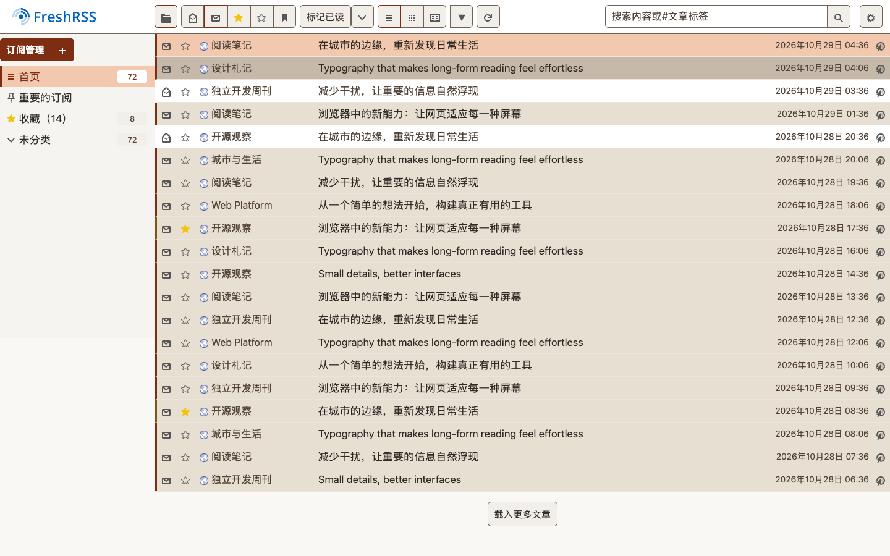
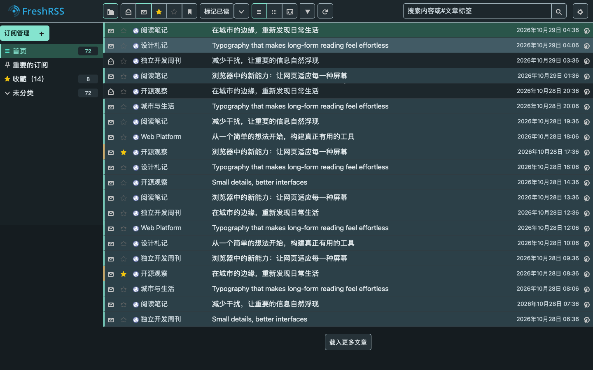

# Crisp for FreshRSS

[English](README.md) | [简体中文](README.zh-CN.md)

紧凑、扁平的 FreshRSS 主题，提供 **Crisp Light** 和 **Crisp Dark** 两套固定配色。

## 截图

以下截图使用示例订阅，展示当前样式：首篇文章为当前选中项，第二篇处于悬浮状态，第三篇和第五篇为已读，其余为未读。

### Crisp Light

暖白底色、暖灰文字与橙色强调色。截图使用示例订阅内容。



### Crisp Dark

墨灰底色、柔和浅色文字与青绿色强调色。截图使用示例订阅内容。



## 设计

Crisp 以 FreshRSS 自带的 Flat design 为起点，通过底色、细分隔线与直角控件区分界面层级。
两套主题共用组件样式与布局，分别定义配色，保持阅读和操作体验一致。

- **紧凑列表**：减少订阅列表和文章列表的上下留白，适当增大文字，正文保留舒适行距。
- **正文层级配色**：浅色正文使用暖棕、青绿和蓝灰标题，粗体使用金棕；深色正文分别使用柔珊瑚、浅青绿和雾蓝，粗体使用浅金。H1–H6 各有颜色，较低级标题逐渐收敛到蓝灰，保留原有字号、字重和间距。高亮在浅色主题使用淡麦色底与深棕文字，在深色主题使用暗橄榄金底与浅米色文字。斜体保留所在文字的颜色；标题、链接、代码和高亮内的粗体沿用上下文颜色，来源的内联颜色继续保留。
- **正文间距**：普通段落行距为 `1.395`，上下间距为 `0.54em`；没有段落标签的直接正文和简单文字容器也使用同一行距。去掉正文容器的上下内边距，首末内容若为普通段落，再去掉朝外的段距。正文标题上方 `1.4em`、下方 `0.6em`。隐藏只含空白、`&nbsp;` 或换行的空段落及简单空容器；正文和普通块首尾的换行全部隐藏，中间连续换行压成一次，保留断行而不增加空白行。包含代码或预格式文本的段落保留原有段距与继承的行距。
- **简化订阅侧栏**：未读数字去掉底色，贴近行尾，宽度随位数变化，为标题留出更多空间。隐藏已停止的订阅；报错订阅使用普通文字样式，订阅和分类均不显示错误图标。订阅悬停提示保留错误详情，已停止的订阅仍可在管理页查看。
- **合并顶栏**：搜索框与“标记已读”等操作排列在同一栏，窄屏或浏览器放大后自动换行。2px 分隔线清楚划分顶栏与阅读区。
- **简化日期分组**：按接收、发布或修改时间排序时，隐藏日期分组标题和跳转链接，保留文章时间与来源、分类分组。
- **明显的悬浮反馈**：浅色主题使用更深的暖灰底色，深色主题使用更亮的蓝灰底色，覆盖按钮、导航、菜单和文章标题行。
- **选中状态**：导航与当前文章使用选中底色和侧边标记，悬浮时仍保留选中提示。按钮选中仅改变边框颜色，文字、图标和底色保持普通状态的样式；悬浮、按压和键盘焦点仍有独立反馈。
- **阅读状态**：已读与未读文章使用不同底色，保持相同字重。当前文章即使已收藏，仍保留当前位置的强调边线；星标与已读、未读图标各自表达状态。通知等提示继续使用较柔和的背景。
- **控件易辨识**：按钮和输入框使用比分隔线更清楚的边框，按压反馈即时出现；禁用控件保留已有选中标记，同时停止悬停反馈。颜色过渡遵循减少动态效果设置。
- **紧凑底部操作**：“全部设为已读”的大按钮缩为约三行文字的高度，缩小勾选图标，并去掉额外的一屏留白。
- **固定配色**：浅色背景使用淡米白；在 FreshRSS 中选择浅色或深色主题，不随系统颜色偏好变化。
- **支持 RTL**：随主题提供从右向左书写语言所需的样式文件。

正文整理仅作用于 FreshRSS 网页中的文章内容，不改写数据库或订阅原文，也不影响第三方客户端。
代码、表格、媒体、空锚点、可见装饰及通过 `white-space` 保留空白的区域保持原排版；Flex／Grid 子树不参与整理，以保留占位元素、间距和排列。自带布局的容器保留其间距、内边距和行距；包含这些区域的外层直接文字保守地保留来源行距。`display: none` 的内容不打断换行识别，`display: contents` 中的可见文字仍会参与整理。
普通 HTML 中作者刻意添加的连续多行空白同样会被压缩；需要逐字保留空白的内容应使用预格式区域。
用于清除浮动的换行保留其布局作用。空占位元素具有非 `auto` 的内联 `height`、计算后大于零的 `min-height` 或内边距时，会连同内部内容一起保留。此项占位识别不覆盖仅通过样式表设置的 `height`；普通段落的默认外边距不会阻止空白清理。
整理会在初次加载、打开文章和加载更多时运行，正文替换后可再次处理，并保留原有节点与事件。

## 安装

需要已有的 FreshRSS 安装。本仓库仅包含主题，基础样式与图标由 FreshRSS 提供。

1. 下载本仓库，或使用下面的命令克隆。
2. 将仓库中的 **`Crisp` 和 `Crisp-Dark` 两个目录**复制到 FreshRSS 的 `p/themes/` 目录。
3. 在 FreshRSS 的显示设置中选择 **Crisp Light** 或 **Crisp Dark**。

```sh
git clone https://github.com/wookiisky/Freshrss-Theme-Crisp.git
cp -R Freshrss-Theme-Crisp/Crisp Freshrss-Theme-Crisp/Crisp-Dark /path/to/FreshRSS/p/themes/
```

请将 `/path/to/FreshRSS` 替换为实际安装路径。两个主题目录必须保持原名、位于同一级；
深色主题会从 `Crisp` 目录加载共享的 CSS 和 JavaScript，因此需要一起安装。

## 打包

在仓库根目录运行，需要已安装 Node.js、npm、POSIX shell 和 `zip`（macOS 或 Linux）：

```sh
npm run build
```

命令从当前工作区生成 `dist/freshrss-theme-crisp.zip`，包含尚未提交的修改。压缩包根目录包含 `Crisp/`、`Crisp-Dark/`、中英文 README 和许可证。解压后，将两个主题目录一起复制到 FreshRSS 的 `p/themes/` 目录。

打包包含现有 RTL 样式和缩略图，不重新生成 CSS；开发文件和系统杂文件不会进入压缩包。每次构建都会重新生成并替换旧包，因此已删除的源文件不会残留。打包无需安装 npm 依赖或 FreshRSS。

运行 `npm run test:package` 可检查压缩包内容、重复打包和失败处理；这些测试还需要 `unzip`。

## 文件与测试

- `Crisp/light.css`：浅色配色。
- `Crisp-Dark/dark.css`：深色配色。
- `Crisp/crisp.css` 与 `Crisp/layout.css`：共享组件样式和响应式布局。
- `Crisp/crisp.js`：移动原有工具栏、识别日期排序并整理正文间距，保留现有控件、正文节点与事件处理。
- `*.rtl.css`：生成的 RTL 样式，维护时应从对应 CSS 重新生成。

在仓库根目录使用 Node.js 运行交互与配色测试：

```sh
node --test tests/frontend/*.test.mjs
```

浏览器状态测试另外需要开发依赖、已安装的 Google Chrome 和一份 FreshRSS 源码：

```sh
npm ci
FRESHRSS_ROOT=/path/to/FreshRSS npm run test:browser
```

测试使用 FreshRSS 的实际基础 CSS、图标及代表性的组件结构，覆盖明暗主题和 LTR／RTL 下的选中、未读与收藏组合、禁用、按压、键盘焦点和减少动态效果，也验证正文段距、空行压缩、代码与媒体保护、动态加载及窄屏文字放大。缺少 FreshRSS 文件或 Chrome 时会明确失败，不会跳过检查。可通过 `CRISP_BROWSER_CHANNEL` 选择其他已安装的 Playwright 浏览器通道。安装和使用主题不需要这些开发依赖。

## 来源与许可

设计参考 [FreshRSS](https://github.com/FreshRSS/FreshRSS) 的 Flat design 主题。
本仓库保留 FreshRSS 的 GNU AGPL v3 许可证，详见 [LICENSE.txt](LICENSE.txt)。
